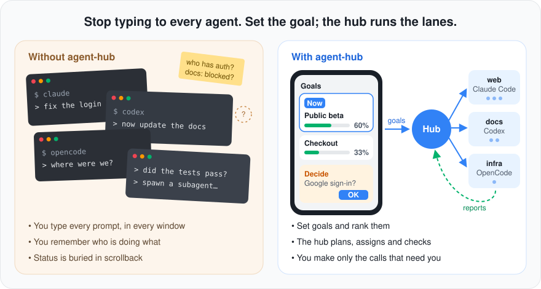
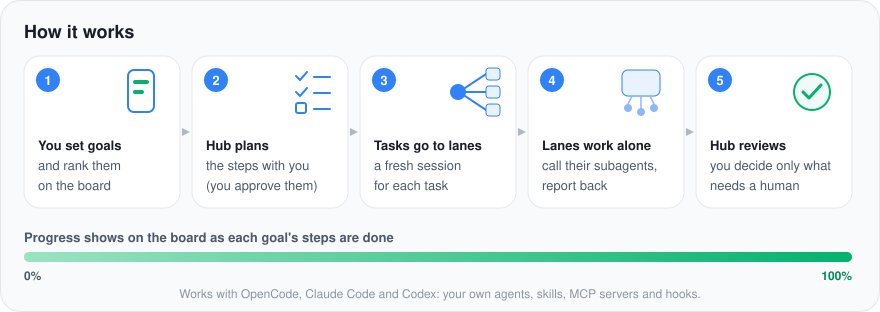
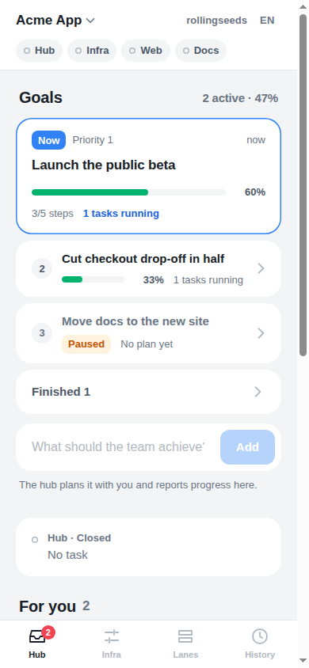
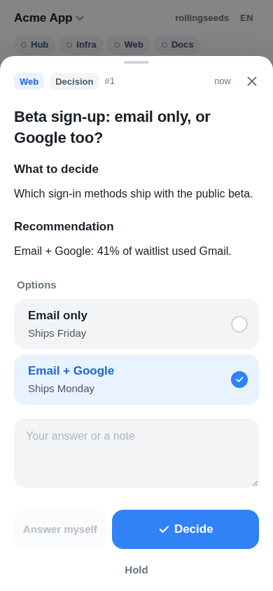

# agent-hub

**Stop typing to every agent. Set the goal; the hub runs the lanes.**

How long will you keep five terminals open, re-explaining context to each agent session, spawning subagents by hand, and digging through scrollback to find out who finished what? agent-hub turns that around. You write down what you want done and in which order. One always-on **hub** agent plans it with you, hands the work to agent sessions it controls (**lanes**: OpenCode, Claude Code or Codex, mixed freely), checks what comes back, and reports to a review board on your phone. You only step in for the calls that need a human.



## What you get

- **Goals, not prompts.** Add as many goals as you like, rank them, pause or drop them. The board shows which goal the team is on now and how far each one is (its achievement rate is the share of its agreed steps that are done).
- **A hub that runs the team.** It agrees a plan with you, splits it into tasks, starts a fresh agent session per task (up to `max_lanes` at once), nudges stalled lanes, reviews results against the real output, and decides what is inside the approved scope.
- **Lanes that work on their own.** Each lane is your agent as you configured it, with your instruction files, skills, MCP servers, hooks and subagents. It reports `done`, `blocked` or posts a decision; it never waits in chat.
- **A board instead of chat.** Decisions with options, reviews of artifacts (images, video, text inline), memos to the hub or to infra, history. Built for a phone; translated into English, 한국어, 日本語, 中文 and Español.
- **Your setup, your rules.** Lane instructions, runtimes, models, agents, permissions, notifications, auth and hosting are plain files you (or the infra lane) edit. The tower in the middle is a small Python loop with no LLM in it.



<p align="center">
  
  &nbsp;&nbsp;
  
</p>

## Install

Python 3.10+ and nothing else (standard library only). Pick the tool you already have:

```sh
pipx install git+https://github.com/twglhk/agent-hub      # or
uv tool install git+https://github.com/twglhk/agent-hub   # or
npm install -g github:twglhk/agent-hub                     # npm wraps the same Python code
```

Check with `tower -h`. Or skip installing: `git clone https://github.com/twglhk/agent-hub` and use `agent-hub/bin/tower`.

## Set it up: ask your agent

Setup is agent-driven, because every team keeps its agents, docs and servers somewhere different. Open your coding agent in your workspace and say one of:

> Install agent-hub in this project.

> Install agent-hub globally.

**In this project**: the agent follows the setup playbook (`tower guide`): it surveys how you work (`tower discover`: agent CLIs, their configs, MCP servers, skills, where your knowledge lives, hosting tools), asks you a handful of questions (which agents run the hub and infra, board language, where your team's memory lives, how your phone should reach the board), writes `.tower/` with lane instructions tailored to your workspace, starts the tower, adds your first goals, and checks the whole loop end to end.

**Globally**: the agent installs the `tower` command for your user and runs `tower skill install`, which adds an `agent-hub-setup` skill (Claude Code) and command (OpenCode, Codex) to your agents after showing you the diff. From then on, "set up agent-hub here" works in any workspace.

If your agent cannot find the playbook, point it at [agent_hub/guide/SETUP.md](agent_hub/guide/SETUP.md).

### By hand

```sh
cd ~/my-workspace
tower init --name "My Team" --lang en --hub claude --infra claude   # writes .tower/, picks free ports
tower start                                                          # tower + board, URL printed
tower goal add "Launch the public beta" --detail "sign-up open, onboarding under 2 minutes"
tower status
```

## One board, every project

Each workspace has its own tower, state and board port. `tower init` registers it on this machine (`tower workspaces` lists them), and every board can switch to the others from its title: other workspaces are served under `/w/<name>/`. Expose one board and you reach all your projects from the phone; a workspace that only trusts local visitors stays hidden behind a board that signs people in.

## Reach the board from your phone

The board listens on `127.0.0.1` by default. `tower guide <name>` prints each path:

| situation | path |
| --- | --- |
| phone on the same Wi-Fi, trying it out | `tower guide lan`: listen on the network, token sign-in |
| Tailscale on the machine and the phone | `tower guide tailscale`: `tailscale serve`, identity from Tailscale |
| a domain on Cloudflare | `tower guide cloudflare`: Tunnel + Access (email code, Google, GitHub, Okta …) |
| agents on a server | `tower guide aws`: EC2 with one of the above, or an ALB with OIDC |

Push notifications (ntfy, Slack, desktop) tell you when something needs you.

## Concepts

| | |
| --- | --- |
| **goal** | an outcome you want, ranked against the others. The first active goal is what the team works on now. The hub agrees its steps with you; progress is the share of steps done. Add, rank, pause, finish and drop goals on the board or with `tower goal`. |
| **hub** | the always-on lane. Turns goals and requests into tasks, reviews results, decides inside approved scope, escalates the rest to people. |
| **lane** | one agent role with its own session: `hub`, `infra`, and any team lanes you add (`tower lane add docs --runtime codex`). Instructions live in `.tower/lanes/<lane>.md`; edit them freely. |
| **task** | a brief the hub gives a team lane, usually for one step of a goal. Each task runs in a fresh session; the tower closes it when the lane wraps. |
| **item** | something a human or the hub must decide: a `decision` with options or a `review` of an artifact. |
| **memo** | what people write on the board: to the `hub` (the work, priorities) or to `infra` (the system: lanes, models, access). Each gets a reply on the board. |
| **infra** | the lane that maintains the tower itself: adds lanes, changes models, sets up access, one memo per fresh session. |

**Memory is yours.** agent-hub keeps the board's history (goals, decisions, reports, memos) and nothing else. Where your team keeps decisions and notes (a memory MCP, a wiki, a docs folder) is your choice: setup writes it into the lane instructions, and lanes record there the way you normally do.

The working rules every lane follows are in [`templates/PROTOCOL.md`](agent_hub/templates/PROTOCOL.md).

## Runtimes

| runtime | how the tower drives it | live `ask` to the board |
| --- | --- | --- |
| `opencode` | `opencode serve --port P` per lane, HTTP API. You can also run `opencode --port P` yourself and watch the TUI; the tower then uses it and never kills it. | yes |
| `claude` | `claude -p --session-id` to start, `claude -p --resume` for each prompt | no (lanes post items instead) |
| `codex` | `codex exec --json` to start, `codex exec resume` for each prompt | no |

Each lane runs your agent as you configured it. Set `"agent"` on a lane to run one of your own agents (OpenCode agent name, Claude `--agent`), `"model"` to pick a model, `"args"` for anything else. Lanes run unattended, so by default Claude runs with `bypassPermissions` and Codex without its sandbox; `tower init --safe` writes sandboxed arguments instead.

## Language

`--lang` takes any language code: agents write everything people read on the board in that language. The board's buttons and labels come in English, Korean, Japanese, Chinese and Spanish; each viewer can switch them from the board's header.

## Teams

`auth.mode` in `.tower/tower.json`:

- `local` (default): the board listens on 127.0.0.1 only; whoever can reach it is the owner.
- `header`: a proxy authenticates people and passes an identity header (Cloudflare Access, Tailscale Serve, an AWS ALB with OIDC). Only trusted from the local proxy. `tower member add ana --ident ana@company.com` turns it into an allow-list.
- `token`: `tower member add ana --token` prints a sign-in token for the board.

Every decision records who made it, and the hub can route an item to one person (`tower escalate ID --to ana`).

## Development

```sh
python3 -m unittest discover -s tests -t .
```

Tests drive the adapters against stand-in CLIs and a stand-in OpenCode server; no model is called. See [AGENTS.md](AGENTS.md) for the layout and rules.

## License

MIT
