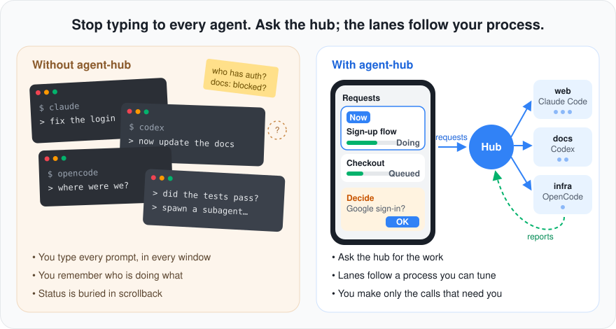
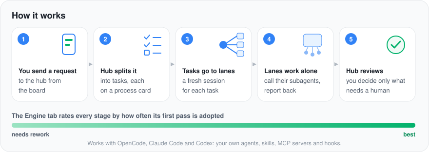
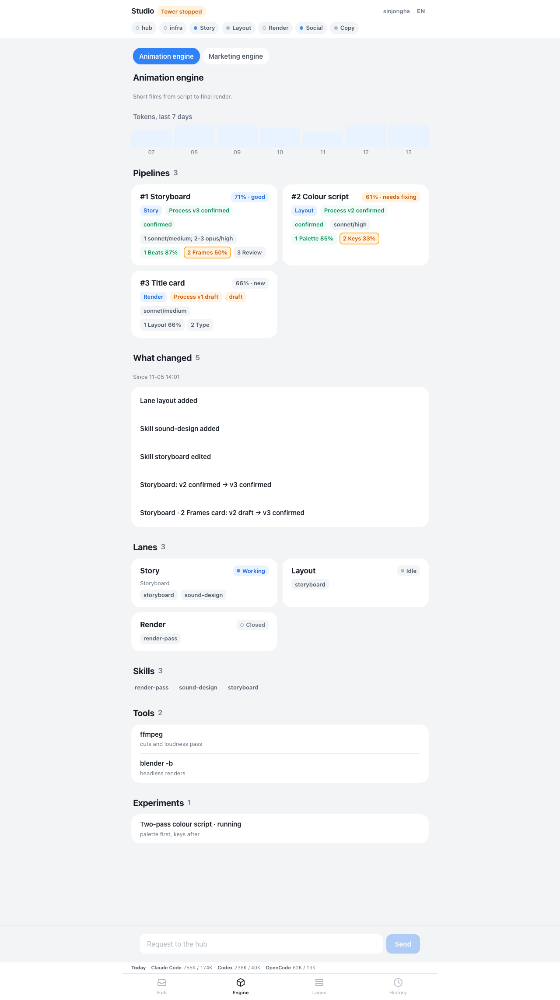
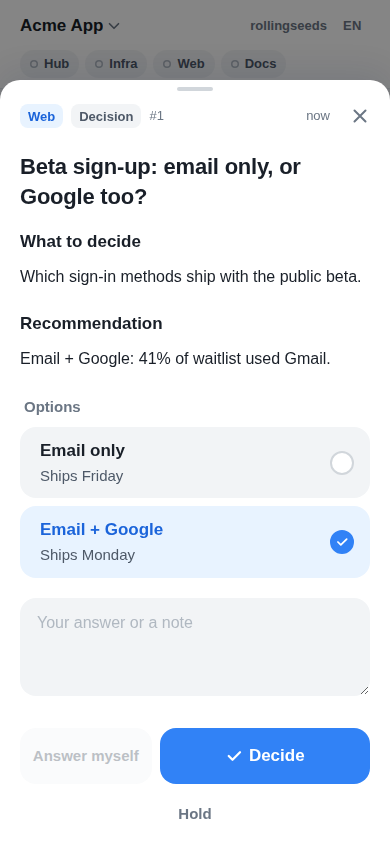

# dongduni-agent-hub

**Run your agents as an engine that gets better, not as five terminals you re-brief.**

You run several agent sessions. Each time, you re-explain the context, spawn subagents by hand, dig through scrollback for who finished what, and fix the same kind of mistake again next week. agent-hub turns that into a small production line. One always-on **hub** agent takes your requests, hands the work to agent sessions it controls (**lanes**: OpenCode, Claude Code or Codex, mixed freely), checks what comes back, and reports to a review board on your phone. The lanes of one **engine** share a written method: for each kind of deliverable, a process card with its stages and a pattern card per stage. The board rates every stage by how often its first pass was adopted, so you see which part of the method to fix next. You only step in for the calls that need a human.



## What you get

- **An engine, not a prompt pile.** A process library holds sub-processes (a process card with its stages, who does each, and a pattern card per stage saying what a good result looks like) and full processes (one deliverable: sub-processes in order, with model and effort). A lane lists the full processes it runs. A brief says `Line: <full> / <sub> · stage 2 · make`, and the lane runs that stage with that card. `dah engine add NAME --from blank|animation|marketing` scaffolds one to edit; several engines can live in one install, each with its own lanes and skills.
- **Ratings that point at the weak stage.** `dah deliverable` records what the human did with a result; `dah blame` names the stage that should have caught a failure. The Engine tab shows per stage and per process whether it is new, good, best, or needs fixing, how often it was sent back, and what a task cost in tokens. A weekly snapshot lists what changed in lanes, skills and cards.
- **A hub that runs the team.** It turns a request into tasks, starts a fresh session per task, nudges stalled lanes, reviews results against the real output, and decides what is inside the approved scope. Humans reach infra only through the hub.
- **Lanes that work on their own.** Each lane is your agent as you configured it, with your instruction files, skills, MCP servers, hooks and subagents. It reports `done`, `blocked` or posts a decision; it never waits in chat. Tasks that declare `paths:` run in parallel when they do not overlap; a memory guard renews bloated sessions when they are idle.
- **A board instead of chat.** Decisions with options, reviews of artifacts (images, video, text inline), a request box on every tab, per-lane sheets (process, stage now, model, effort, tokens), history. Built for a phone; English, 한국어, 日本語, 中文 and Español.
- **Your setup, your rules.** Lane instructions, runtimes, models, agents, permissions, notifications, auth and hosting are plain files you (or the infra lane) edit. The tower in the middle is a small Python loop with no LLM in it.



<p align="center">
  
</p>

<p align="center">
  
</p>

> **Agents:** asked to install or set up agent-hub / dongduni-agent-hub? Install the package (`uv tool install dongduni-agent-hub`, or `pipx install dongduni-agent-hub`; for one project only, see [Install](#install)), then run `dah guide` and follow that playbook phase by phase. It is also [online](https://github.com/twglhk/dongduni-agent-hub/blob/main/agent_hub/guide/SETUP.md).

## Install

One package for Windows, macOS and Linux: [`dongduni-agent-hub`](https://pypi.org/project/dongduni-agent-hub/) on PyPI. It needs Python 3.10+ and nothing else, and installs one command, **`dah`**.

```sh
uv tool install dongduni-agent-hub     # recommended: uv brings its own Python if you have none
pipx install dongduni-agent-hub        # or, if you use pipx
```

No uv yet? It is one line: `curl -LsSf https://astral.sh/uv/install.sh | sh` (macOS, Linux) or `powershell -c "irm https://astral.sh/uv/install.ps1 | iex"` (Windows). Check with `dah -h`; upgrade with `uv tool upgrade dongduni-agent-hub`.

Only for one project, without touching your user: `uv venv .tower/venv && uv pip install --python .tower/venv dongduni-agent-hub`, then run `.tower/venv/bin/dah` (`.tower\venv\Scripts\dah` on Windows).

## Set it up: ask your agent

Setup is agent-driven, because every team keeps its agents, docs and servers somewhere different. Open your coding agent in your workspace and say one of:

> Install dongduni-agent-hub in this project.

> Install dongduni-agent-hub globally.

**In this project**: the agent follows the setup playbook (`dah guide`): it surveys how you work (`dah discover`: agent CLIs, their configs, MCP servers, skills, where your knowledge lives, hosting tools), asks you a handful of questions (which agents run the hub and infra, board language, where your team's memory lives, how your phone should reach the board), writes `.tower/` with lane instructions tailored to your workspace, starts the tower, sends your first request to the hub, and checks the whole loop end to end.

**Globally**: the agent installs the `dah` command for your user and runs `dah skill install`, which adds an `agent-hub-setup` skill (Claude Code, Codex) and command (OpenCode) to your agents after showing you the diff. From then on, "set up agent-hub here" works in any workspace.

If your agent cannot find the playbook, point it at [agent_hub/guide/SETUP.md](https://github.com/twglhk/dongduni-agent-hub/blob/main/agent_hub/guide/SETUP.md).

### By hand

```sh
cd ~/my-workspace
dah init --name "My Team" --lang en --hub claude --infra claude   # writes .tower/, picks free ports
dah start                                                          # tower + board, URL printed
dah engine add studio --from blank                                 # optional: a method with cards to edit (dah guide engines)
dah status                                                         # then send the hub its first request from the board
```

## Update

```sh
dah update            # in the workspace: upgrade dah, bring .tower/ up to date, restart the tower
dah update --all      # every workspace on this machine
```

It upgrades the package the way you installed it (uv tool, pipx, a project venv), then brings each workspace to the new version without losing your setup: protocol and lane files whose template you only added to get the new template with your sections kept, files you edited get the new template beside them as `.new` and a request to infra to merge them, and known `tower.json` fixes are applied. The tower loop restarts on the new code; lane sessions keep running. You can also ask infra on the board to do it. Nothing updates by itself.

`dah restart` restarts only the tower loop on the current code (when the tower runs under systemd, or with `DAH_SERVICE=1` in its environment for another service manager, `dah restart` waits up to 15 s for the service to bring it back; otherwise it starts it at once); lane sessions keep running. `dah infra "..." --model opus --effort high` opens the infra session for that request with them. The board's state lists each lane's real model and effort (read from its Claude Code transcript) under `run`, and `/api/machine` lists each data disk's usage under `machine.disks` (root first, then other real disks; green below 85 % used, amber below 95 %, red above; `/boot` and snap images are left out and the disks do not count toward the machine's overall grade). Inside a tower session `TOWER_LANE` decides who `dah` acts as: `--as` naming the session's own base lane (`--as docs` in `docs#2`) means itself, any other lane is refused. Installed packages run the lane hook as `python -m agent_hub.hooks`, so a reinstall that moves files cannot make open sessions' tool calls fail.

Package files someone changed in place (the installed board, its Python) are kept before the upgrade replaces them: copies and a diff against the release go to `.tower/patches/<version>/`, and infra gets a request to rebuild them as extensions. `dah update --dry-run` lists them.

To go back to a release: `uv tool install --force dongduni-agent-hub==X.Y.Z` (or `pipx install --force ...`), then `dah update --no-upgrade`.

## Uninstall

```sh
dah uninstall                 # shows what it would remove; changes nothing
dah uninstall --yes           # stop the tower, close lane sessions, take agent-hub out of the workspace
dah uninstall --yes --purge   # ... and delete .tower/ too
dah skill uninstall --yes     # the global agent-hub-setup skill/command, if you installed it
uv tool uninstall dongduni-agent-hub   # or: pipx uninstall dongduni-agent-hub
```

`dah uninstall` removes only what agent-hub wrote: the `/dah-<lane>` shortcuts still as written (edited ones stay), its `.gitignore` lines, lane worktrees without uncommitted work (their `dah/<lane>` branches stay), and the workspace's entry in this machine's list. `.tower/` (config, lane files, extensions, board history) stays unless you pass `--purge`. It lists lines in your `AGENTS.md` / `CLAUDE.md` that still point at `.tower/` for you to remove.

## Extend it

agent-hub is a skeleton: build what your team needs on top of it in the workspace's `.tower/`, which lives in your git and survives updates. Ask infra on the board, or write it yourself (`dah guide extend`):

| | |
| --- | --- |
| `.tower/board/extra.js`, `extra.css` | sections, tabs and styles added to the board (`window.dah.addSection`, `addTab`, `get`, `post`, ...) |
| `.tower/board/index.html` | your own board instead of the built-in one (`?builtin` always opens the built-in board) |
| `.tower/ext/*.py` | API routes at `/api/x/<name>`; tower hooks: `on_event` (reports, items, decisions, memos, tasks, lane status), `on_notify` (every push to people, e.g. to another chat) and `on_tick`; new agent runtimes and terminal apps (`runtimes`, `terminals`) |

Built-in routes and the tower's decisions stay the contract; a broken extension is logged and skipped. Updates never touch `.tower/`; when the built-in board changes, `dah update` asks infra to check the workspace's board additions (the guide lists which parts stay stable). To change agent-hub itself, run it from a clone (see Development).

## One board, every project

Each workspace has its own tower, state and board port. `dah init` registers it on this machine (`dah workspaces` lists them), and every board can switch to the others from its title: other workspaces are served under `/w/<name>/`. Expose one board and you reach all your projects from the phone; a workspace that only trusts local visitors stays hidden behind a board that signs people in.

## Reach the board from your phone

The board listens on `127.0.0.1` by default. `dah guide <name>` prints each path:

| situation | path |
| --- | --- |
| phone on the same Wi-Fi, trying it out | `dah guide lan`: listen on the network, token sign-in |
| Tailscale on the machine and the phone | `dah guide tailscale`: `tailscale serve`, identity from Tailscale |
| a domain on Cloudflare | `dah guide cloudflare`: Tunnel + Access (email code, Google, GitHub, Okta …) |
| agents on a server | `dah guide aws`: EC2 with one of the above, or an ALB with OIDC |

Push notifications (ntfy, Slack, desktop) tell you when something needs you.

## Concepts

| | |
| --- | --- |
| **engine** | a set of lanes around one full process of the process library (`processes/`), the skills its cards name, and an engine review lane. An install with no `engines` in `tower.json` has one implicit engine, `default`. |
| **full process** | one deliverable: the sub-processes it runs in order (`processes/full/<id>.md`), with model and effort for each. Owned by no lane; a lane file lists the full processes it uses under `## Processes used`. |
| **sub-process** | a process card (`processes/sub/<id>/process.md`): the stages of one kind of work, who does each, the gate to leave it. Several full processes may share one. Briefs name it with a `Line:` header. |
| **pattern card** | what a good result looks like at one stage: the recipe and the checks. Status runs draft, collecting, confirmed, tuned. |
| **hub** | the always-on lane. Turns requests into tasks, reviews results, decides inside approved scope, escalates the rest to people. |
| **lane** | a role with its own session: `hub`, `infra`, and any team lanes you add (`dah lane add docs --runtime codex`). A lane is not a new agent: it is a role file (`.tower/lanes/<lane>.md`, edit freely) put on the agent you already use, with your hooks, skills and plugins. Every lane also gets a `/dah-<lane>` shortcut so you can open the role by hand in Claude Code, OpenCode or Codex. |
| **task** | a brief the hub gives a team lane, usually for one stage of a process card. Each task runs in a fresh session; the tower closes it when the lane wraps. |
| **item** | something a human or the hub must decide: a `decision` with options or a `review` of an artifact. |
| **request** | what people write in the box on every board tab: to the hub (the work, priorities). Your answer to each arrives as a review card to confirm. Changes to the system itself (lanes, models, access) go through the hub to infra. |
| **infra** | the lane that maintains the tower itself: adds lanes, changes models, sets up access, one request per fresh session. Only the hub sends it work. |

**Memory is yours.** agent-hub keeps the board's history (decisions, reports, requests, the ledger of tasks and ratings) and nothing else. Where your team keeps decisions and notes (a memory MCP, a wiki, a docs folder) is your choice: setup writes it into the lane instructions, and lanes record there the way you normally do.

The working rules every lane follows are in [`templates/PROTOCOL.md`](https://github.com/twglhk/dongduni-agent-hub/blob/main/agent_hub/templates/PROTOCOL.md).

## Runtimes

| runtime | how the tower drives it | live `ask` to the board |
| --- | --- | --- |
| `opencode` | `opencode serve --port P` per lane, HTTP API. You can also run `opencode --port P` yourself and watch the TUI; the tower then uses it and never kills it. | yes |
| `claude` | `claude -p --session-id` to start, `claude -p --resume` for each prompt | no (lanes post items instead) |
| `codex` | `codex exec --json` to start, `codex exec resume` for each prompt | no |

Another agent CLI can be added as an extension: a `runtimes` entry in `.tower/ext/*.py` (`dah guide extend`), then `"runtime": "<its name>"`.

Each lane runs your agent as you configured it. When a role needs its own prompt, model or tool limits, point the lane at one of your existing agents (`dah lane add review --runtime claude --agent code-reviewer`, or `"agent"` in `tower.json`: an OpenCode agent name or a Claude `--agent`); `"model"` picks a model, `"args"` passes anything else (Codex: `["--profile", NAME]`). Lanes run unattended, so by default Claude runs with `bypassPermissions` and Codex without its sandbox; `dah init --safe` writes sandboxed arguments instead.

### Model and effort per task

A brief can pick its own model and effort with two lines of their own:

```
model: opus
effort: high
```

Claude and Codex lanes start (and resume) that task's session with them (`--model` and `--effort`, or `-c model_reasoning_effort=`); OpenCode lanes keep the lane's configured model. A brief with neither line uses the lane's `model`. Which model and effort to pick: [guide/MODELS.md](agent_hub/guide/MODELS.md) (`dah guide models`).

Two optional keys in `tower.json` (top level):

- `"require_model_lines": true`: `dah task` refuses a brief without both lines, so the hub decides small-before-strong for every task.
- `"stage_table": "docs/process-table.md"`: a markdown table (first column `#`, one column whose header contains "model", cells like `1-2 sonnet/medium; 3 opus/high`). A brief that says `Line: row 3 stage 2` takes its model and effort from that row; lines in the brief win over the table, the table over the lane's `model`. See `agent_hub/stagemodel.py`.

For a Claude lane with its own harness, set `"agent": "<name>"` and put `.claude/agents/<name>.md` in the workspace; [`docs/lane-harness-claude.md`](docs/lane-harness-claude.md) is a ready harness section for unattended lanes. The working methods behind the lane instructions are in [`docs/engine-playbook.md`](docs/engine-playbook.md). `dah init` also writes starter content: the subagents `explore`, `librarian`, `looker` and `general` (`.claude/agents/`, Claude lanes) and the skills `humanizer` (plain English without AI tells), `media-reading` (reading video, web pages, PDFs and books on a shared machine), `review-board` (posting and answering board items) and `project-audit` (a whole-project clean-up the hub sends to infra when a stronger model ships). Edit or delete them; `dah update` refreshes only untouched copies. `tools/skill_lint.py [repo]` (a clone of this repository only; standard library) lints OpenCode skills (frontmatter, names, dead links, size budgets).

### Done gate, scratch and the machine card

Optional keys in `tower.json` (top level):

- `"done_gate": {"paths": ["src", "tests"], "command": "python -m pytest -q"}`: when a task's commits since it started touch one of `paths`, `dah report done` returns at once and the gate runs in the background; pass sends the done to the hub, fail tells the lane the last lines and the log path, and the lane fixes, commits and reports again. While the gate runs the lane is not nudged. Optional `setup` and `verify` (the command runs only after `verify` passes; up to three tries), `timeout` (seconds per step, 1800) and `memory_mb` (ceiling on the command's process tree, 8192; 0 = off; not enforced on Windows). Only committed work is tested, on ONE persistent git worktree outside the project that every gate reuses (`checkout` of the new commit and `clean`; ignored caches stay), one gate at a time. `"sparse"` limits that worktree to some folders. See `agent_hub/donegate.py`.
- `"context_limit_k": 120` (default off): a team lane session whose context passes this many k tokens is asked to hand off (`dah report handoff "[mode] fresh|compact ..."`); `fresh` continues the task in a new session, `compact` runs `/compact` in the same one (Claude Code lanes; other runtimes fall back to fresh). It can be a table by model name, matched as a substring of the model (`{"default": 400, "sonnet": 300, "opus": 400}`), and a lane may set its own `context_limit_k`. The hub always hands over to a fresh hub session through `dah report handoff` past its own `context_limit_k` (default 300).
- `"leftover_sweep": true` (default off, Linux only): every 5 minutes the tower looks for processes of lanes whose session is closed or replaced (found through the `TOWER_HOME`/`TOWER_LANE` they inherited), stops them when they are seen on two checks in a row, and tells the hub. A process counts as left over when its lane is gone from `tower.json`, its lane has no session now, its command line names a session id other than the lane's current one, or it names none and started before the lane's current session.
- `"scratch_root"` (default `<your user cache dir>/agent-hub/dah-<hash>`, made private to you; a root that is a symlink or belongs to another user is refused) and `"scratch_grace"` (600 s): the folder outside the project that holds the gate worktree and the scratch lanes get from `dah scratch [--worktree]`. Scratch is removed once its task has been closed or cancelled for the grace period, and a lane worktree (`"worktree": true`) whose lane is gone is removed when it has no uncommitted work (its branch stays). Removals and sizes go to `.tower/state/scratch.log`. Nothing outside that list is ever removed.
- `"usage_percent": "claude"`: the footer shows the Claude subscription's 5-hour and weekly percent. It reads the login Claude Code keeps (macOS keychain or `~/.claude/.credentials.json`) without changing it, and asks an undocumented Anthropic endpoint that may change at any time; any failure shows "unknown". Off by default.

The Lanes tab has a machine card (load per core, CPU, free memory, swap, each green, amber or red against this machine's own cores and RAM; "unknown" where the system does not say, never 0) and each queued task shows why it waits (slot full, lane busy, `paths:` conflict, usage cap). `GET /api/machine` serves the same.

### Lanes in terminal windows

By default lane sessions run in the background and you follow them on the board. To watch them work, set `"terminal"` in `tower.json` (for every lane, or per lane) or pass `dah init --terminal`:

| `terminal` | where a lane's session runs |
| --- | --- |
| `none` (default) | in the background, as in the table above |
| `tmux` | a window per lane in the tmux session `dah-<workspace>` (`tmux attach -t dah-<workspace>`; `dah status` prints it). Linux, macOS, WSL. |
| `orca` | a terminal tab per lane in [Orca](https://github.com/stablyai/orca), opened with its `orca` CLI; Orca shows each lane's state in its sidebar |
| any other name | a terminal app an extension registers (`terminals` in `.tower/ext/*.py`) |

The tower opens the window when a lane starts, gives it its briefs (written to a file, the window gets one line pointing at it), and closes it when the lane is done; `dah stop --close-lanes` closes them all. The agent runs interactively with the same configuration and arguments, so you can scroll, read along and type to it. The tower knows when it works or waits from Claude Code hooks and Codex `notify`, both added for that session only (your own Claude hooks still run, and your own Codex `notify` program still gets every notification); OpenCode runs its TUI, which the tower drives over HTTP as before. With `--safe` arguments an agent in a window stops at its own permission prompts until someone answers there; the lane shows as `asking` and the tower sends one alert.

Good to know: open each agent once by hand in the workspace first, so first-run screens (folder trust, accepting `bypassPermissions`) are out of the way; a lane cannot answer them. Changing a lane's `terminal` or `runtime` closes its live session, which then reopens the new way. Codex reports only finished turns, so the tower does not see a turn a person starts or interrupts in a Codex window; Claude Code reports both.

### Lanes in their own git worktree

Team lanes share one checkout with each other and with you by default. Set `"worktree": true` on a team lane (or at the top level for every team lane; `dah lane add ID --worktree`) and its sessions run in a git worktree of their own, `.tower/state/worktrees/<lane>` on branch `dah/<lane>`, created from your current commit the first time the lane opens. Each parallel session of the lane (`<lane>#2`, below) gets its own: `.tower/state/worktrees/<lane>-2` on `dah/<lane>-2`. The lane commits there and reports the branch (`dah status` and the board show the branch beside each session); the hub reviews it (`git diff HEAD...dah/<lane>`) and merges it, or asks you on the board. Nothing lands in your checkout by itself. With `terminal: orca` the lane's tab opens in that worktree. The hub and infra always work in the workspace itself.

`"max_instances": N` (top level, default 1) lets a busy team lane open up to N sessions at once, `<lane>#2` ... `<lane>#N`, for queued tasks whose `paths:` do not overlap with the live ones. A team lane may set its own `"max_instances"` (a whole number, 1 or more), which wins over the top-level value for that lane. Without `"worktree"` the sessions share the workspace.

Optional, all off by default (`tower.json`): `"branch_sync": true` merges your current branch into a worktree lane's branch before each task (fast-forward, else a merge commit; a conflict is undone, the task stays queued and the hub is told). `"branch_sync_seconds": 300` does the same every 300 s for idle lane branches, and `"branch_sync_push": true` additionally pushes them to `origin` (never forced). On a conflict the merge is aborted and the branch is left as it was; a worktree with uncommitted edits is skipped by the idle catch-up, and holds a task back before its start (the hub is told). Each session (`lane`, `lane#2` ...) syncs its own worktree and branch, and only while it is idle. A conflict is not merged again until main or the branch moves.

### Scheduled runs

Off by default. `"schedules"` in `tower.json` queues a task for a team lane, or a request to the hub, once per day or week. With no `schedules` key, or an empty list, nothing happens.

```json
"schedules": [
  {"lane": "docs", "every": "week", "day": "mon", "at": "09:00", "title": "Weekly docs review",
   "text": "model: sonnet\neffort: medium\n\nReview last week's changes and list the docs that are out of date."},
  {"lane": "hub", "every": "day", "at": "08:30", "text": "Summarise what is open on the board."}
]
```

| key | |
| --- | --- |
| `lane` | required: a team lane (gets a task, `text` is its brief, so `model:` and `effort:` lines work) or `hub` (gets a request, as if a person sent it; the sender is `schedule`) |
| `every` | required: `"day"` or `"week"` |
| `day` | with `"week"`: `mon` `tue` `wed` `thu` `fri` `sat` `sun` (default `mon`); not allowed with `"day"` |
| `at` | 24-hour local time `"HH:MM"` (default `"09:00"`) |
| `text` | required: the task brief or the request |
| `title` | optional task title (default: the first line of `text`) |
| `id` | optional name the last run is remembered under (default `lane-every-day-time`, e.g. `docs-week-mon-0900`); give two entries with the same lane and time different ids |

A bad value is a config error that names the entry. The tower checks on every tick, with the machine's local time, and remembers the last period it fired in its database, so a restart never fires a period twice. A period that passed while the tower was down fires once at the next tick, not once per missed period. A schedule seen for the first time starts from the period it is in: adding a Monday 09:00 schedule on Wednesday waits for next Monday. Editing `text` does not fire again; changing `lane`, `every`, `day` or `at` of an entry without an `id` makes it a new schedule.

## Requirements and limits

- Python 3.10+ for `dah`, and at least one agent CLI (OpenCode, Claude Code or Codex) installed and signed in. Lanes use your agent accounts: every lane session counts against your subscription or API usage.
- By default lanes run unattended with your user's rights: Claude with `bypassPermissions`, Codex without its sandbox. `dah init --safe` writes sandboxed arguments; then a lane stops at anything not allowed (`--allowedTools` in its `args`), and a lane in a window waits at the prompt until someone answers.
- Lanes without `"worktree"` edit the same checkout as each other and as you.
- Claude lane sessions are ordinary Claude Code sessions: they show up in `claude --resume` for the workspace. The `/dah-<lane>` shortcuts live in the workspace (`.claude/commands/`, `.opencode/command/`, `.agents/skills/`), so they go into its git unless you ignore them.
- Live `ask` to the board works with OpenCode only; Claude and Codex lanes post board items instead.
- Lane windows: tmux on Linux, macOS and WSL; Orca anywhere it runs, and the only choice on Windows. Orca support is tested against a stand-in of its CLI, not a real Orca yet. Codex in a window reports finished turns only.
- The board reaches your phone only through a path you set up (`dah guide`); by default it listens on this machine.

## Language

`--lang` takes any language code: agents write everything people read on the board in that language. The board's buttons and labels come in English, Korean, Japanese, Chinese and Spanish; each viewer can switch them from the board's header.

## Teams

`auth.mode` in `.tower/tower.json`:

- `local` (default): the board listens on 127.0.0.1 only; whoever can reach it is the owner.
- `header`: a proxy authenticates people and passes an identity header (Cloudflare Access, Tailscale Serve, an AWS ALB with OIDC). Only trusted from the local proxy. `dah member add ana --ident ana@company.com` turns it into an allow-list.
- `token`: `dah member add ana --token` prints a sign-in token for the board.

Every decision records who made it, and the hub can route an item to one person (`dah escalate ID --to ana`).

The Lanes tab's "Add a lane" row opens a text box: what the new lane should do. It goes to the sender's own hub (the one hub of a single-user install) as a request whose first line is `[New lane request]`; the hub answers with a card proposing the lane, and only after someone decides does it ask infra to create it.

Each person has screen settings of their own (the sliders icon in the board's top bar): the tab that opens first, text size, accent colour, and the order, folding and hiding of the Hub and Lanes tab sections. They are stored in the tower database per member (`member_prefs`), apply at once and only to that person's board, and a person can only read and write their own. `?default` in the board address ignores them. The hub changes them on a chat request with `dah prefs show|set|reset MEMBER` (for example `dah prefs set ana first_tab=history font=l accent=green hub.order=yours,asks lanes.hidden=reports`; an empty value is the default); with person hubs on, only the hub that serves that member can. Nothing to switch on.

The hub can reorder the waiting work: `dah task bump ID` puts a queued team task first (the next free session of its lane takes it), `dah memo bump ID` puts a waiting infra memo first. A bump goes ahead of `fair_turns` once; after the task starts, turns go on as before. The latest bump goes in front of an earlier one.

### Team options in `tower.json`

All off by default; a single-user install behaves as before.

- `"requester": true`: a task records who asked for it (`dah task LANE --request N` takes the sender of board request N, `--for ana` names the person). Cards that lanes and the hub post for that task default to that person (`dah item add --to ana`, `--to all` for everyone, `--request N` on the hub) and show on the Hub tab of that person only (everyone sees them in a local-mode board and in the history). `dah escalate` keeps the person; `--to all` widens it. The hub's reply card to a request is for the sender. Infra's answers and its `wrapped` reach the hub as news (`infra_reply`, `wrapped`). A lane card on the board shows "for <person>" next to its task. The board server enforces it for members (`visibility.py`): hub-side cards, other people's chat and infra memos are not sent to them, whatever the browser filters. A member sees the hub chat they wrote and the hub's answers, plus, with `person_hubs`, everything in their own hub (its cards, chat and the infra memos it sent); the owner sees all. With `person_hubs` on, another member's hub (its cards, chat and infra memos) is hidden even when `requester` is off; the shared hub chat then stays visible to everyone.
- `"person_hubs": true` (or `{"max": 3, "auto": false, "domains": []}`; default `false`): one always-on hub per board member, a copy of the hub lane called `hub-<member>` (the id is made from the member name: lower case letters, digits, `-` and `_`; a name with no Latin letter gets a short hash). Each member's board requests go to their own hub, the Hub tab shows their hub and the cards of the tasks it queued, and news about a task (reports, cards, decisions, done gates, stalls) goes back to the hub that queued it. The team lanes and the task queue stay shared; every hub may task, decide, escalate and ask infra. `max` caps how many hubs run (each is a live agent session that uses memory): members past it wait in line (shown on their board, one board item tells humans), the default hub takes their requests, and the first in line gets a hub when a member is removed. `dah member add/remove` reload the member list; `dah member list` shows each member's hub. `"auto": true` (needs `auth.mode` `header`): a person the proxy lets in who is not a member yet joins on their first visit (the first one becomes owner) and sees a wait screen until their hub is ready; `domains` limits that to those email domains. Lane ids starting with `hub-` are reserved while this is on, and so are member names `hub` and `hub-…`.
- `"fair_turns": true`: when the tower picks the next waiting team task, each requester's first waiting task comes before anyone's second, so one person's long list does not fill every free session (work already running counts as that person's turn). A task whose `after:` task has finished still goes first. Off: oldest first. `dah status` then lists whose each waiting task is and how many wait per person.

## Development

```sh
git clone https://github.com/twglhk/dongduni-agent-hub && cd dongduni-agent-hub
python3 -m unittest discover -s tests -t .
bin/dah -h          # runs from the clone without installing
```

The board is a React app: its source is `board-app/`, its build is committed under `agent_hub/board_next/` and ships in the package, so nobody needs Node to use agent-hub. Change the board with `cd board-app && npm ci && npm run build` and commit the source and the build together (CI fails when they differ). The board before the React app is still served at `/old/` (`agent_hub/board/index.html`).

Releasing (from any machine with push access): [docs/RELEASING.md](https://github.com/twglhk/dongduni-agent-hub/blob/main/docs/RELEASING.md). Tests drive the adapters against stand-in CLIs and a stand-in OpenCode server; no model is called. See [AGENTS.md](https://github.com/twglhk/dongduni-agent-hub/blob/main/AGENTS.md) for the layout and rules.

## License

MIT
